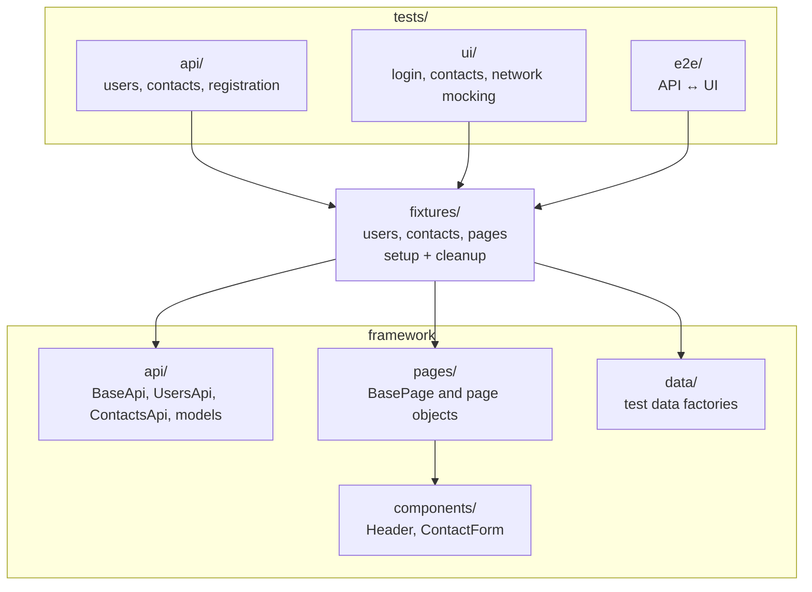

# Playwright E2E

[](https://github.com/piotrwaligora/playwright-e2e/actions/workflows/tests.yml)
[](https://piotrwaligora.github.io/playwright-e2e/)

- **CI pipeline:** [GitHub Actions runs](https://github.com/piotrwaligora/playwright-e2e/actions/workflows/tests.yml)
- **Latest test report:** [Playwright HTML report on GitHub Pages](https://piotrwaligora.github.io/playwright-e2e/) (updated after every merge to `main` and daily)

API and UI test automation framework in TypeScript with Playwright, testing a real application:
the [Contact List App](https://thinking-tester-contact-list.herokuapp.com/)
([REST API docs](https://documenter.getpostman.com/view/4012288/TzK2bEa8)).
It covers the same application as my Java/Selenium project
[selenium-e2e](https://github.com/piotrwaligora/selenium-e2e), so the two can be compared side by side.

## Highlights

- **Fixtures instead of base classes**: test data is created through the API before a test and removed after it, also when the test fails
- **REST API layer**: API clients built on Playwright's `request`, with typed requests and responses
- **Page Object Model with components**: pages are composed of reusable components (header, contact form)
- **Hybrid tests**: data created through the API is verified in the UI, and data entered in the UI is verified through the API
- **Network mocking**: mocked and modified API responses, server errors and network failures with `page.route()`
- **Data-driven tests**: one registration scenario run for 10 data sets
- **Parallel execution**: 2 workers on one machine, and the suite split across 2 CI machines with sharding
- **Cross-browser**: Chromium and WebKit locally, plus Firefox on CI
- **Debugging artefacts**: trace, screenshot and video kept for every failed test
- **Code quality**: strict TypeScript, ESLint (including a rule that catches a missing `await`) and Prettier
- **CI**: GitHub Actions on every push and pull request, one merged HTML report published to GitHub Pages

## Tech stack

| Area                               | Technology                                                     |
| ---------------------------------- | -------------------------------------------------------------- |
| Language                           | TypeScript (strict)                                            |
| Runtime                            | Node.js LTS                                                    |
| Test runner and browser automation | Playwright Test                                                |
| API testing                        | Playwright `APIRequestContext`                                 |
| Browsers                           | Chromium, WebKit, Firefox (CI)                                 |
| Reporting                          | Playwright HTML report, trace viewer                           |
| Code quality                       | ESLint (typescript-eslint, eslint-plugin-playwright), Prettier |
| CI/CD                              | GitHub Actions, GitHub Pages                                   |

## Architecture



### Design decisions

| Decision                                      | Where                      | Why                                                                                                                                                                                                                                |
| --------------------------------------------- | -------------------------- | ---------------------------------------------------------------------------------------------------------------------------------------------------------------------------------------------------------------------------------- |
| Fixtures instead of base test classes         | `fixtures/index.ts`        | A test asks for what it needs (`user`, `contact`, `contactListPage`). A fixture is set up only when requested, and its cleanup runs even when the test fails. Fixtures depend on each other instead of inheriting from each other. |
| Factory fixture for users                     | `registerUser`             | A test may register any number of users. Every one is deleted afterwards, together with its contacts.                                                                                                                              |
| Login with the API token                      | `contactListPage` fixture  | Only the login tests use the login form; every other UI test starts logged in through the session cookie, which is faster and more stable.                                                                                         |
| Small `BasePage`, components by composition   | `pages/`, `components/`    | `BasePage` holds only what every page has (its path and `goto()`). Parts shared by several pages are components that a page _has_, not something it inherits.                                                                      |
| User-facing locators                          | page objects               | `getByRole` and `getByLabel` first. An id is used only where an element has no role or label (error messages, read-only details), and the code says why.                                                                           |
| No custom wait wrapper                        | everywhere                 | Playwright waits for elements before every action, and web-first assertions retry until a timeout.                                                                                                                                 |
| Separate `api` project                        | `playwright.config.ts`     | API tests do not open a browser, so they run once instead of once per browser.                                                                                                                                                     |
| Mocks next to real tests, not instead of them | `tests/ui/network.spec.ts` | Mocks cover cases that cannot be produced on the real server (errors, network failures, exact data). API and hybrid tests keep the mocks honest.                                                                                   |

**Finding from the network tests:** when loading the contact list fails (server error or no network), the app shows no error message. The table is just missing, and on a network failure the page throws an uncaught error. The tests document this behaviour.

## Project structure

```
api/                 BaseApi, UsersApi, ContactsApi, models (request/response types)
components/          Header, ContactForm
data/                test data factories: newUser(), newContact()
fixtures/            test.extend: API clients, users, contacts, pages
pages/               BasePage and page objects
tests/
├── api/             API tests (project "api")
├── ui/              UI tests, including network mocking
└── e2e/             hybrid API ↔ UI tests
playwright.config.ts projects, workers, retries, reporters, timeouts
.github/workflows/   CI: checks, sharded tests, merged report, GitHub Pages
```

## Test coverage

| Suite  | Tests | Scope                                                                                                                                                                                         |
| ------ | ----- | --------------------------------------------------------------------------------------------------------------------------------------------------------------------------------------------- |
| API    | 25    | Users: profile, update, login, wrong password, duplicate email, logout, deletion. Contacts: create, list, get, PUT, PATCH, delete, validation, missing token. Registration with 10 data sets. |
| UI     | 13    | Login, wrong password, logout, adding, validation, editing and deleting a contact, network mocking (6)                                                                                        |
| Hybrid | 3     | Contact created through the API shown in the UI; contact added in the UI stored in the API; contact edited in the UI updated in the API                                                       |

UI and hybrid tests run in every browser: 57 test runs locally (Chromium, WebKit), 73 on CI (plus Firefox).

## Getting started

### Prerequisites

- Node.js LTS

### Installation

```bash
npm ci
npx playwright install
```

### Running tests

```bash
npm test                 # all tests
npm run test:api         # API tests only
npm run test:ui          # UI and hybrid tests (@ui)
npm run test:smoke       # smoke tests (@smoke)
npm run test:mock        # network mocking tests (@mock)
npm run test:headed      # with a visible browser (Chromium)
npm run test:ui-mode     # Playwright UI Mode
npm run report           # open the HTML report of the last run
```

Any Playwright option can be added after `--`, for example `npm test -- --project=chromium`.

### Code quality

```bash
npm run check            # format check + lint + type check (the same as on CI)
npm run lint:fix
npm run format
```

### Configuration

| Variable   | Default                                              | Description                                                                       |
| ---------- | ---------------------------------------------------- | --------------------------------------------------------------------------------- |
| `BASE_URL` | `https://thinking-tester-contact-list.herokuapp.com` | Application under test (API and UI)                                               |
| `CI`       | not set                                              | Set automatically on GitHub Actions: 1 retry, Firefox, blob reporter for sharding |

Other settings are in `playwright.config.ts`: 2 workers, 10 s action timeout, 15 s navigation timeout,
5 s assertion timeout, and trace/screenshot/video kept only for failed tests.

## Reports and debugging

- **HTML report** (`npm run report`): every test with its steps, and for failed tests the error, a screenshot, a video and the trace.
- **Trace viewer**: a step-by-step recording of a failed test with the DOM, network requests and console of every step. It opens from the HTML report, locally or on GitHub Pages.

## Continuous integration

The [GitHub Actions workflow](.github/workflows/tests.yml) runs on every push and pull request to `main`, daily, and on demand.

1. **Checks**: format, lint and type check.
2. **Tests**: the suite is split into **2 shards** that run on 2 machines at the same time (`--shard=1/2` and `--shard=2/2`). Each machine runs 2 workers. Each shard saves its results as a blob report.
3. **Report**: the blob reports are merged into one HTML report, which is available as the `html-report` artifact.
4. **GitHub Pages**: on `main`, the merged report is published to [GitHub Pages](https://piotrwaligora.github.io/playwright-e2e/), also when tests fail.

## Test data

Every test registers its own unique user through the API and deletes the user, together with the user's contacts, after the test, also when the test fails. The cleanup logs in again before deleting, because logging out invalidates every token of the user. The application's database is public and purged from time to time, so nothing is left behind between runs.

## Experiments

The branch [`feature/self-healing`](https://github.com/piotrwaligora/playwright-e2e/tree/feature/self-healing) contains a self-healing locator. It is a primary locator with fallbacks, and every use of a fallback is reported in the test results. It is kept out of `main` on purpose: Playwright has no built-in runtime self-healing, and a silent fallback could hide a real change in the application.
